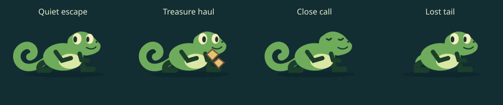

# Sally's reactions

This pass gives Sally small expressions during escapes and a short celebration
after a win. It changes presentation only: facing, detection, collisions, scores,
resources and saved progress still belong to the existing engine.

## During an escape

- Her pupils notice nearby creatures she can actually see; walls, fog, buried
  creatures and disguised mimics cannot trigger a reaction.
- Visible danger widens her eyes and takes priority over a pleased expression.
- Looking back turns the drawn head to match the actual gameplay gaze, with a
  nervous expression and a quiet rustle. It never changes her gameplay facing.
- A successful tongue pickup gets a brief satisfied chew and two-note chirrup.
  Casting or missing does not get the success reaction.
- Losing her tail startles her. When she next stops somewhere safe, she checks
  the stump. Regrowing it gets a pleased face; exhausted Sally looks winded.

These reactions use the simulation clock, freeze on pause and reset on retry.
Reduced motion keeps the expressions but removes pupil scanning and chewing.
Existing sound settings also control the new cues.

## After an escape

Quiet escapes get a look both ways and a knowing smile. Quiet treasure hauls get
a treasure hug and hop. Escapes with alarms or a dropped tail get a relieved
wiggle, including a look at the missing tail when applicable. Sally wears the
selected skin. Animations play once; reduced motion shows the static pose.
Failed attempts have no celebration, and buttons do not wait for the animation.

## Review checklist

- Check a visible hunter, a wall and a dark corner: the face should react only
  to the visible hunter, without obscuring its attack tells.
- In a gaze route, use Space while retreating: the drawn nose should agree with
  the look-back direction. Pause and retry should freeze/reset the expression.
- Tongue-grab a key or treasure; compare with a failed grab. Listen with sound on
  and muted.
- Lose a tail and stop safely, then regrow it. Check the tailless victory pose.
- Compare quiet, treasure-heavy and alarmed wins on desktop and landscape mobile.
  Confirm result controls remain reachable, including after a perfect escape.
- Enable reduced motion: expressions remain, celebration movements stop.

Tests cover the character state, interface, audio, tail, tongue and gaze mechanics.
