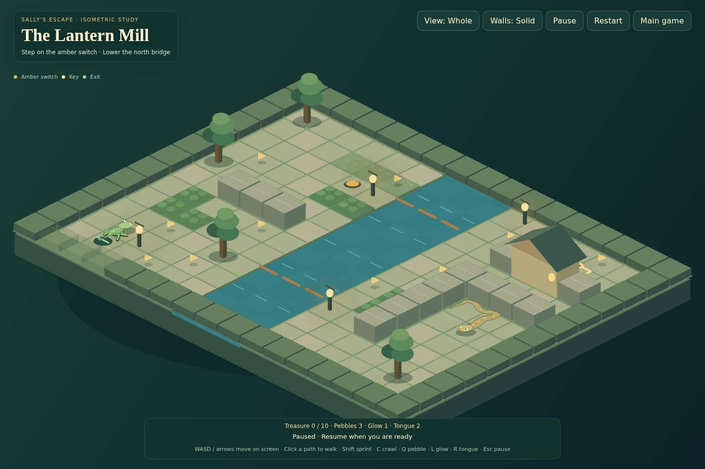
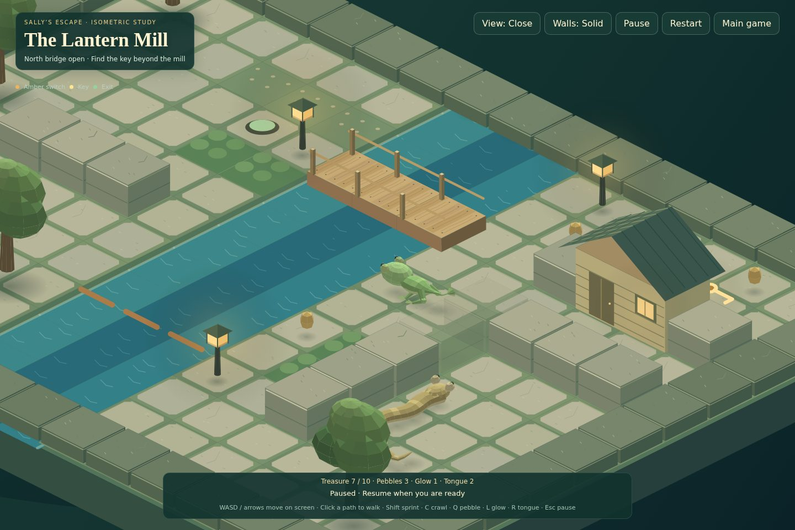
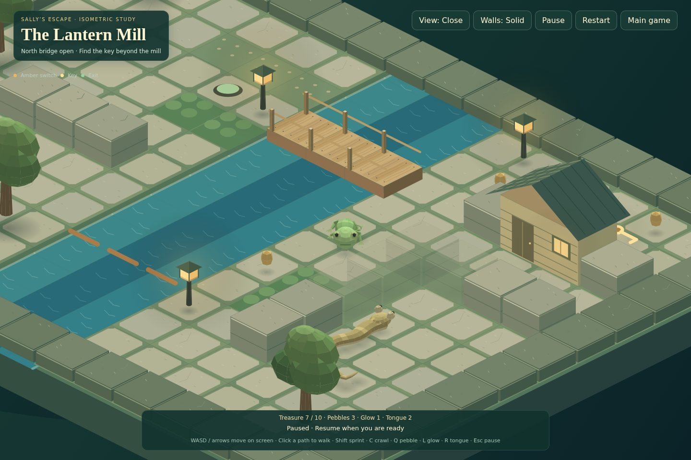
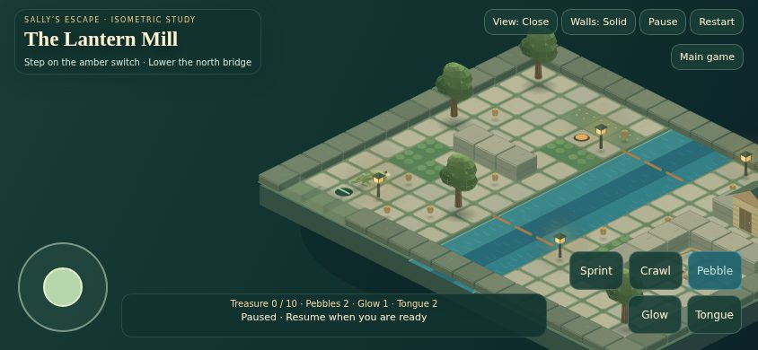
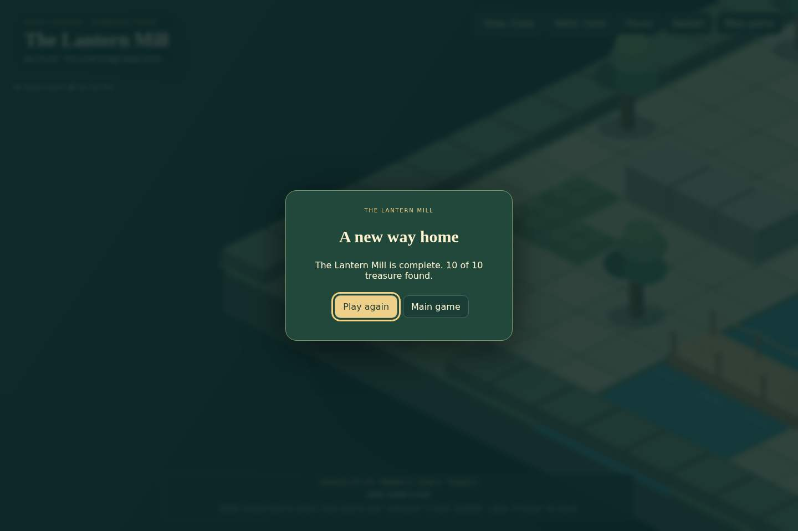

# The Lantern Mill — playable isometric example

A review-only 2.5D rendering experiment for Sally’s Escape. Open **/isometric.html** on a server running this branch. From a checkout: Node 24, `npm ci`, `npm run prepare:static`, `npm start`, then visit `http://localhost:8080/isometric.html`.

## What to review

A compact 17×13 mill garden: step on the amber switch to lower the north bridge, cross the river, find the key beyond the mill, then take the newly lowered south bridge to the green exit. Ten optional treasures are distributed along small detours. A real serpent patrols the walled southeast garden; entering its enclosure is an optional risk and is not required for treasure.

The scene includes bevelled/weathered stone walls and paving, a visible island foundation, timber grain and nails on bridges, rounded tree canopies, a shingled timber mill, depth-coloured river water, framed lanterns, soft ground shadows and depth-sorted articulated creatures. Sally and the serpent are drawn as lit world-space meshes: elliptical body sections follow the native spine, with rounded heads, raised eye sockets, shaded sides/bellies and articulated solid limbs. This is procedural geometry projected into Canvas 2D, not flat replacement sprites. Sally and the serpent use the existing creature rig, not replacement sprite assets. Near foreground walls become translucent; Walls: Low lets reviewers compare visibility. View switches between a whole-diorama composition and a closer following camera.

**This is a flat collision map viewed in isometric projection.** Raised scenery is visual; there is no staircase, jumping, multi-storey navigation or Z-axis physics. The purpose is to assess readability, movement and the game’s art in this view before committing to a wider conversion.

## Playing

- Keyboard: WASD/arrows move relative to the screen, Shift runs, C crawls, Q holds/releases a pebble, L holds/releases a glow mushroom, R uses the tongue, Esc pauses.
- Mouse: click a walkable tile to follow a legal engine route. Direct movement cancels that route.
- Touch: left joystick, Sprint/Crawl holds, Pebble/Glow holds/releases and Tongue tap. Controls appear after touch even when a controller is connected.
- Standard controller: left stick/d-pad move, RT runs, LT crawls, X pebble, LB glow, Y tongue, Start pauses; A retries after a result.
- Restart restores supplies and bridge states. Window blur/visibility change pauses and clears held inputs.

Movement is screen-relative through the projection adapter; the underlying simulation retains normal speed, collision, cover, hunter behaviour, finite supplies and 120 Hz stepping. Projection inversion is used for mouse picking. Decorative motion stops under reduced motion; gameplay remains functional.

## Scope and isolation

The page is deliberately opened directly rather than added to the campaign, seasonal catalog or normal main menu. It instantiates the current EscapeAdventure engine with its own level object. It does not write progress, rewards, play-data summaries, builder drafts or player settings. Main game returns to the ordinary title page.

Only the example page loads its model/renderer/CSS. Campaign renderers, controls and saved levels remain untouched. This prototype is silent: audio integration, campaign lighting parity and expanded enemy/hazard rendering would be follow-up work after visual approval. It supports the creatures and tools used by this sample; it is not a replacement renderer for every existing level.

## Verification

`node --test tests/isometric.cjs` verifies projection round-trips, input rotation/speed, catalog isolation, safe start, pause/reset and actual normal/all-treasure solutions with the native hunter active. `scripts/isometric-tour.cjs` generates real 120 Hz engine inputs without teleporting, disabling creatures or granting tools.

`node scripts/smoke-isometric-browser.cjs` runs real Chrome against the standalone server: desktop/mobile screenshots, real keyboard/touch input, finite tool spending, Gamepad API switching, pause, reduced motion and replay of the all-treasure win in the browser engine. CI also retains the complete game test/browser and image checks.

Screenshots below are actual Chrome captures of the playable page from the refined creature/material build, including the all-treasure replay. They are not concept illustrations. Desktop captures are 1440×960; the touch capture is 844×390. The page is paused during still captures to keep the positions reproducible.

### Whole level

### Close view

### Creature detail

### Phone touch controls

### Completed route

## Files

- `public/isometric.html`, `public/isometric.css`: isolated review entry and accessible controls.
- `public/isometric-model.js`: authored route and pure projection/input helpers.
- `public/isometric.js`: Canvas 2D renderer and projection-aware input adapter.
- `scripts/isometric-tour.cjs`: legal input tour generator.
- `tests/isometric.cjs`, `scripts/smoke-isometric-browser.cjs`: simulation and browser checks.
